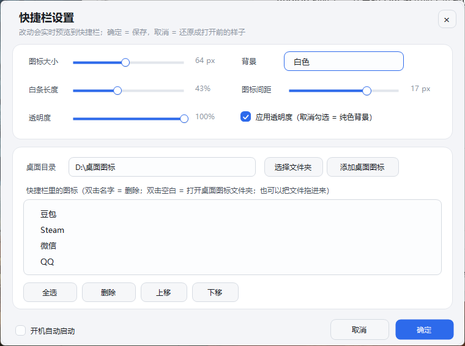

# MyDock · 贴边自动隐藏快捷栏

一个轻量的 Windows 桌面悬浮快捷栏：吸附在屏幕边缘，平时只留一条细条（白条），鼠标靠近自动展开、移开自动收起。纯 C# WinForms 自绘，**单文件 EXE，零第三方依赖**，不需要 Wallpaper Engine 之类的前置软件。




## 特性

- **四边吸附**：左 / 右 / 上 / 下都能停靠，自动跟随工作区（避开任务栏）
- **自动展开收起**：靠白条滑入展开，离开自动收回；不会挡住普通窗口操作
- **鼠标悬停放大**：图标可放大到 1.28 倍，带弹簧缓动
- **两套皮肤**：黑色（带抖动去渐变）/ 白色（玻璃高光），可跟随系统深浅色
- **可调**：图标大小 32–100 px、图标间距 0–24、白条长度、透明度 50–100%（或纯色）
- **图标管理**：从桌面或任意文件夹批量添加 .lnk，列表里拖动排序、上移下移、删除
- **托盘/菜单**：右键白条 → 桌面 / 锁定位置 / 设置… / 退出
- **配置持久化**：`dock.ini` 就近存放，绿色软件，换电脑拷走即可用

## 运行要求

| 项目 | 要求 |
|---|---|
| 系统 | Windows 10 1607+ / Windows 11（Windows 7 SP1 装 .NET 4.x 也可） |
| 运行时 | .NET Framework 4.0 及以上；Win10 / Win11 已预装，无需另外安装 |
| 权限 | 普通用户权限即可，不需要管理员 |

直接运行 `MyDock.exe`，首次启动会在同目录创建 `items\` 和 `dock.log`。

> Win10 上设置窗口的四角是直角（DWM 圆角是 Win11 特性），其余功能一致。

## 使用

1. 双击 `MyDock.exe`（默认吸附屏幕右侧）
2. 鼠标移到白条上，栏杆展开
3. 右键白条 →「设置…」
4. 在设置里选好吸附边、大小、透明度，点「添加桌面图标」或「选择文件夹」把图标加进来
5. 「确定」保存

图标列表的小技巧：**双击名字 = 删除该项**，**双击空白处 = 打开桌面图标文件夹**，滚轮一格滚两行。

## 配置文件

同目录 `dock.ini`，纯文本，可直接改：

```ini
edge=Bottom      ; Left / Right / Top / Bottom
ratio=0.5        ; 白条在吸附边上的位置比例
x=508            ; 自由悬浮时的坐标
y=1252
icon=64          ; 图标尺寸 px
gap=17           ; 图标间距
bgstyle=1        ; 0 黑色 / 1 白色 / 2 跟随系统
bar=39           ; 白条长度（占上限百分比）
alpha=100        ; 透明度
lock=0           ; 1 = 锁定位置
desktop=D:\桌面图标   ; 添加快捷方式时默认打开的目录
```

`items\` 里放的是快捷方式（`.lnk`）和 `order.txt`（排序），属于运行期数据。

## 从源码编译

只用系统自带的 .NET Framework 编译器，不需要装 Visual Studio / .NET SDK：

```bat
"C:\Windows\Microsoft.NET\Framework64\v4.0.30319\csc.exe" ^
  /nologo /codepage:65001 /target:winexe /platform:anycpu /optimize+ ^
  /win32icon:MyDock.ico /out:MyDock.exe ^
  /r:System.dll /r:System.Core.dll /r:System.Drawing.dll /r:System.Windows.Forms.dll ^
  src\DockApp.cs src\SettingsPane.cs src\DockMenu.cs
```

中文源码必须带 `/codepage:65001`（源文件存为 UTF-8 无 BOM），否则编译出来的界面会乱码。

## 目录结构

```
MyDock.exe          编译产物（单文件，已内嵌图标）
MyDock.ico          图标源文件
dock.ini            配置（运行后生成）
使用说明.txt         面向使用者的说明
src/
  DockApp.cs        主程序：分层窗口、吸附/动画、绘制、图标加载、配置
  SettingsPane.cs   设置窗口：自绘控件、主题、列表
  DockMenu.cs       自绘右键菜单
items/              你的图标快捷方式 + order.txt
docs/               README 用的截图
```

## 实现要点

- 整个快捷栏是一个 `WS_EX_LAYERED` 分层窗口，用 `UpdateLayeredWindow` 把一帧 32 位预乘 alpha 位图交给系统合成，所以能做逐像素半透明和柔和描边
- 动画走 10 ms 定时器按真实帧间隔做指数缓动（`1 - exp(-dt/tau)`），避免不同机器上速度不一致
- 设置窗口的列表去掉了原生 `WS_VSCROLL`（`CreateParams` 里改样式），滚轮自己接管，因此列表右侧没有任何滚动条
- 全局单实例：`Global\MyDock_SingleInstance_2026` 互斥体，重复启动会静默退出

## 已知限制

- 没有声明 DPI 感知，125% / 150% 缩放下会被系统整体拉伸，略糊（100% 缩放正常）
- 不支持多显示器混 DPI 的极端场景
- 只处理 `.lnk` 与文件夹，不支持直接把 `.exe` 当图标拖进来（可以先在桌面建快捷方式）

## License

MIT
